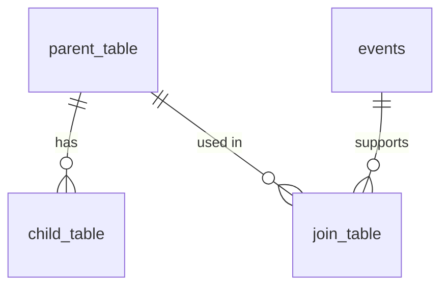
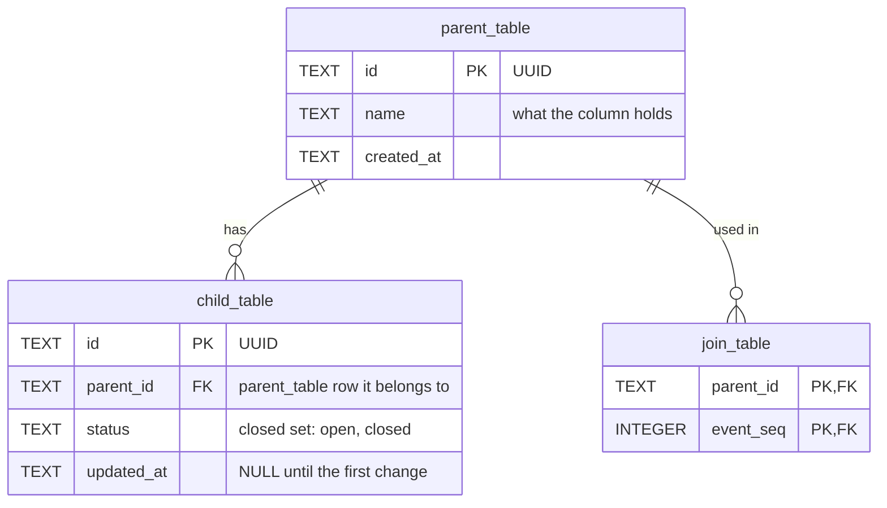

<!--
ERD template, taken from the structure of docs/ERD.md.

How to use it:
1. Copy this file to ERD.md in the target project.
2. Replace every {{PLACEHOLDER}}. `grep -n '{{' ERD.md` lists the ones left.
3. Replace the example table names in the Mermaid blocks (parent_table, child_table,
   join_table, events). Mermaid entity names allow only letters, digits and
   underscores, so these are written as plain names, not as {{...}}.
4. Copy section 5 once for each group of related tables, then renumber the sections
   after it and the Contents list.
5. Delete these HTML comments when the document is done.

Placeholders use {{...}}, not angle brackets, so the placeholder check in
CONTRIBUTING.md does not report this template.
-->

# {{PROJECT_NAME}} — database design

| | |
|---|---|
| **Document** | Entity-relationship design for {{WHAT_THE_STORE_IS}} |
| **Status** | {{STATUS — for example: Proposed, with ADR NNNN. The design becomes binding when that ADR is accepted}} |
| **Date** | {{YYYY-MM-DD}} |
| **Author** | {{AUTHOR}} |
| **Source of requirements** | {{SPEC_ID}} version {{SPEC_VERSION}} ([`{{SPEC_FILE}}`]({{SPEC_FILE}})) |
| **Related decisions** | {{ADR_LIST — one short reason for each ADR}} |
| **Writing standard** | {{WRITING_STANDARD — for example: ASD-STE100 rules for sentence structure}} |

## Contents

1. [Purpose and scope](#1-purpose-and-scope)
2. [Terms](#2-terms)
3. [Design decisions](#3-design-decisions)
4. [Overview diagram](#4-overview-diagram)
5. [{{AREA_TITLE}}](#5-{{area-title-anchor}})
6. [Deletion and erasure](#6-deletion-and-erasure)
7. [Traceability](#7-traceability)
8. [Open items](#8-open-items)

## 1. Purpose and scope

This document gives the logical design of {{THE_STORE — for example: the one SQLite
file that holds all application data}}. It shows each table, each column group, each
relationship, and the reason for each design decision.

The design covers {{SCOPE — for example: all use cases of the specification, and the
data categories in its privacy requirement}}.

This document does not contain migration scripts. It does not change the code.
{{MIGRATION_STATE — which migration the current store uses, and which ADR decides
how the store moves to this design}}

## 2. Terms

<!-- Define every word that this document uses with a narrower meaning than usual.
Keep the rows below that apply to the design, and delete the others. -->

| Term | Meaning in this document |
|---|---|
| State table | A table that holds data the user owns and can read, correct or delete. A state table is the source of truth for its data |
| Cache table | A table that the application computes from other tables. The application can delete a cache table and compute it again with no loss |
| Tombstone | A row that keeps only enough data to stop a rejected result from coming back. A tombstone holds no user text |
| {{TERM}} | {{MEANING}} |

## 3. Design decisions

{{WHO_DECIDED — for example: The author made each decision below during the design
review of YYYY-MM-DD.}}

<!-- One row per decision. Give the reason, and name the requirement or ADR that the
reason comes from. Typical decisions: the engine, the key type, the time format,
state tables against an event log, typed columns against JSON, how evidence and
provenance are linked, how deletion and tombstones work. -->

| # | Decision | Reason |
|---|---|---|
| D-01 | {{DECISION}} | {{REASON, with requirement or ADR IDs}} |
| D-02 | {{DECISION}} | {{REASON}} |

### 3.1 Rules for all tables

<!-- Rules that every table obeys, so that the per-table sections need not repeat
them. Examples from docs/ERD.md: every table is STRICT; foreign keys are switched on
for each connection; secure_delete is on; the format of a UUID, a timestamp, a local
day and a boolean; which ON DELETE action each kind of foreign key uses. -->

1. {{RULE}}
2. {{RULE}}

## 4. Overview diagram

This diagram shows all tables and their relationships. Sections 5 to {{LAST_AREA_SECTION}}
show the columns.

<!-- Cardinality notation:
     ||--o{  one to zero or more        ||--|{  one to one or more
     ||--o|  one to zero or one         |o--o{  zero or one to zero or more
     }o--||  zero or more to exactly one
     The label in quotes reads from the left table to the right table. -->

{{TABLES_NOT_SHOWN — name each table that is not in the diagram, and say why}}

## 5. {{AREA_TITLE}}

<!-- One section for each group of related tables. The diagram gives the columns:
TYPE name KEY "comment". KEY is PK, FK, UK, or a list such as PK, FK. Put the range,
the closed set of values or the NULL meaning in the comment. -->

### 5.1 `{{table_name}}`

**Purpose.** One row holds one {{THING}} ({{REQUIREMENT_IDS}}).

<!-- Add one bold-titled paragraph for each design point that a reader needs: how
rows are written (immutable, append-only, updated), what a NULL means, why a column
exists, why a column does NOT exist, and which use case reads the table. Name the
requirement or use case each time. Examples of titles from docs/ERD.md: Immutability,
Exact text, Reason and evidence, No history, Privacy by shape, Cache. -->

**{{TOPIC}}.** {{EXPLANATION}}

<!-- Optional: a table for a column group whose values need a range or a meaning. -->

| Column | Range | Meaning |
|---|---|---|
| `{{column}}` | {{RANGE}} | {{MEANING}} |

**Constraints.**

- {{CONSTRAINT — for example: `UNIQUE (number)`, or `CHECK (status IN ('open', 'closed'))`}}

### 5.2 `{{join_table_name}}`

**Purpose.** One row links one {{THING}} to one {{OTHER_THING}}.

**Reason.** {{WHY_A_JOIN_TABLE — for example: a foreign key makes each link a fact
that the database checks}}

## 6. Deletion and erasure

### 6.1 One item

| The user removes | The application does this in one transaction |
|---|---|
| {{ITEM}} | {{STEPS — which rows go, which go by cascade, which tombstone is written}} |

If any step fails, the transaction rolls back. The item stays exactly as it was.

### 6.2 Erase levels

<!-- One column for each erase level that the specification defines. -->

| Table | {{ERASE_LEVEL_1}} | {{ERASE_LEVEL_2}} |
|---|---|---|
| `{{table_name}}` | {{Kept / Deleted / Reset}} | {{Kept / Deleted / Reset}} |

**Order.** {{ORDER — for example: what is counted before the user confirms, and what
runs after the deletes so that no deleted page stays in the file}}

**Failure.** {{FAILURE_REPORT — how a partial erasure is reported}}

## 7. Traceability

<!-- Every requirement that touches stored data appears once. A requirement that the
design meets by leaving something out names what is left out. -->

| Requirement | Tables |
|---|---|
| {{REQUIREMENT_IDS}} | `{{table_name}}`, `{{table_name}}.{{column}}` |

## 8. Open items

These items are outside this design, or need a decision before implementation.

1. **{{TITLE}}.** {{WHAT_IS_OPEN, and who or which ADR decides it}}
